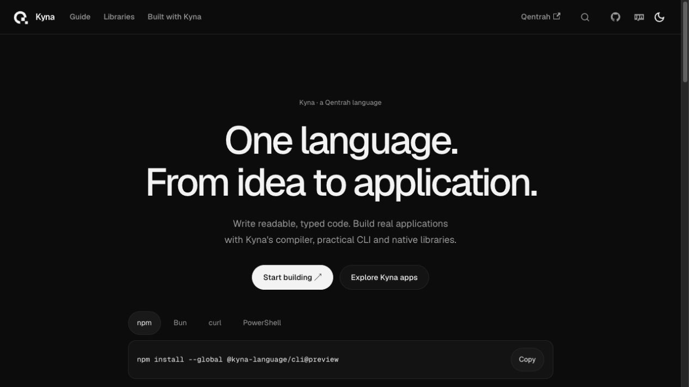

# Kyna documentation

The source for the [Kyna documentation website](https://up-to-code.github.io/kyna-docs/),
built with [Docusaurus](https://docusaurus.io/).


<p align="center">
  
</p>

## Work locally

Requires Node.js 20 or newer.

```sh
npm install
npm start
```

The development server opens at `http://localhost:3000` and reloads when a page
changes.

## Verify a change

```sh
npm run build
npm run serve
```

`npm run build` checks routes and produces the static site in `build/`.

## Content structure

```text
docs/
  intro.mdx       overview and learning paths
  tutorial/       guided lessons
  reference/      language behavior and APIs
  stdlib/         standard-library modules
  examples.mdx    practical recipes
  built-with-kyna.mdx  application gallery and build tour
  libraries/      optional native GUI, geometry and ML packages
src/
  pages/          landing page
  components/     shared React components
  css/            site theme and responsive layout
```

Keep tutorials task-focused and explain one concept at a time. Put precise
language behavior in `reference/`, and standard-library APIs in `stdlib/`.

## Deployment

Every push to `main` is built and deployed to GitHub Pages by
`.github/workflows/docs.yml`.

```sh
npm run deploy
```

Manual deployment requires authenticated GitHub access.

The compiler and language implementation live in
[qentrah/Kyna](https://github.com/qentrah/Kyna). The npm installer is
[`@kyna-language/cli`](https://www.npmjs.com/package/@kyna-language/cli).
## Brand and media

The theme follows [Qentrah](https://qentrah.com/): Geist typography, neutral surfaces and the current Qentrah mark. Light and dark marks replace the former purple K logo. Actual Kyna Music screenshots and its silent walkthrough are copied from the [application repository](https://github.com/qentrah/kyna-music); original app assets are CC0. No Spotify images or recordings are shipped.

## Design verification

Production builds and route checks pass. The theme was inspected in light/dark mode and at a 390-pixel mobile width; navigation, app-table scrolling, installer copying, search results/focus/closure and actual video playback were verified. Rams quick_review was requested with via set to rules, but the workspace has exhausted its one-time credits and returned no findings. This is not a Rams approval.
